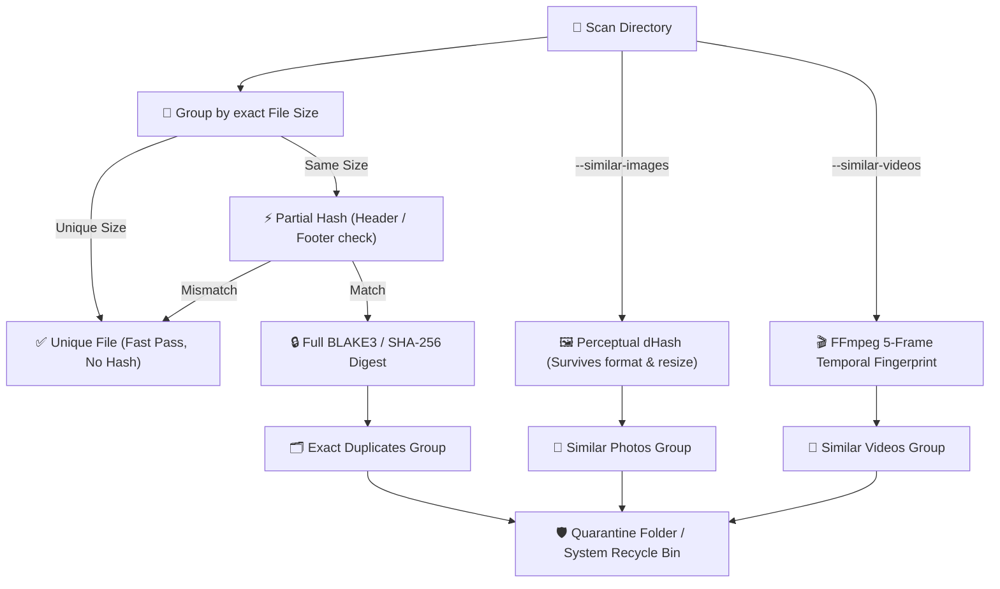

<div align="center">

# 🔍 Argos-Cleaner
### Intelligent, Safe Duplicate Media Cleaner & Google Photos Takeout Organizer

[](https://python.org)
[](https://github.com/Kaio-Comk/Argos-Cleaner)
[](https://github.com/Kaio-Comk/Argos-Cleaner)
[](https://github.com/Kaio-Comk/Argos-Cleaner)
[](https://github.com/Kaio-Comk/Argos-Cleaner)
[](https://opensource.org/licenses/MIT)

**Find duplicate photos and videos by content — not just by name — and safely clean them up.**  
*Includes a native modern Windows GUI, Google Photos Takeout organizer & EXIF fixer, and zero cloud uploads.*

[Windows App](#-windows-app-no-python-required) • [Key Capabilities](#-key-capabilities) • [Pipeline](#-how-the-detection-engine-works) • [Google Photos Takeout Fixer](#-google-photos-takeout-organizer) • [CLI Usage](#-cli-usage) • [Mobile Companion](#-companion-mobile-app)

</div>

---

## 🌟 Key Capabilities

| Detection Mode | Technology | What it Solves |
|---|---|---|
| **Exact Duplicates** | Size filter ➔ Partial Hash ➔ Full BLAKE3 / SHA-256 | Bit-for-bit identical files across any extension or directory structure. Extremely fast staged I/O. |
| **Similar Photos** | Perceptual Hashing (dHash) | Catches images resized, recompressed (JPEG vs PNG), or with minor watermarks. |
| **Similar Videos** | FFmpeg 5-frame temporal fingerprinting | Detects the same video clip re-encoded, re-muxed, or with different bitrates. |
| **Google Photos Takeout** | Fast ExifTool batch processing (`stay_open`) | Merges JSON metadata sidecars back into photos/videos and repairs incorrect extensions. |

---

> [!NOTE]
> **Branding & Identity:** **Argos-Cleaner** is the open-source repository name. **TwinFinder** is the portable Windows desktop executable distribution (`TwinFinder.exe`).

---

## 💻 Windows App (No Python Required)

1. Download **`TwinFinder.exe`** from the [Latest GitHub Release](https://github.com/Kaio-Comk/Argos-Cleaner/releases/latest).
2. Launch the application (features modern Sun Valley theme with dark/light mode support).
3. Follow the intuitive 4-step wizard:
   * **Step 1:** Select folders to scan.
   * **Step 2:** Choose criteria (Exact duplicates, Similar Photos, Similar Videos, resolution priority).
   * **Step 3:** Visually inspect groups with image preview and keep/remove toggles.
   * **Step 4:** Safely clean to an isolated **Quarantine folder** or system **Recycle Bin**.

> **Tip for Video Comparison:** Place `ffmpeg.exe` and `ffprobe.exe` in the same directory as `TwinFinder.exe` or on your system `PATH`.

---

## 🏗️ How the Detection Engine Works



---

## 📸 Google Photos Takeout Organizer

Google Takeout exports photos and videos stripped of their original EXIF timestamps, dumping metadata into separate `.json` sidecars.

TwinFinder includes an integrated, high-speed **Google Photos Takeout Processor**:
* **High Performance:** Uses `exiftool` in persistent `stay_open` daemon mode for lightning-fast batch processing of tens of thousands of media files.
* **Metadata Restoration:** Injects capture dates, GPS coordinates, and descriptions back into image EXIF and video metadata headers.
* **Extension Mismatch Repair:** Identifies files named `.jpg` that are actually `.png` or `.mp4` and fixes extensions automatically.
* **Clean Organization:** Flattens chaotic yearly folders into a standardized, organized archive.

---

## 🛡️ Safety Guarantees

* **Non-Destructive by Default:** TwinFinder never hard-deletes your files permanently without explicit confirmation.
* **Mirrored Quarantine:** Moved files are placed into a `twinfinder-quarantine` folder preserving the original folder hierarchy, making restorations instantaneous.
* **Guaranteed Survivor:** At least one master file in every detected group is guaranteed to be preserved.
* **Change Detection:** If a file was modified or deleted between scan and cleanup, it is safely skipped.
* **Hardlink & Symlink Awareness:** Hardlinks pointing to the same inode/storage are recognized and never treated as duplicates; symlinks are never traversed.

---

## ⚡ CLI Usage

```powershell
# 1. Inspect library and generate JSON report (Non-destructive)
twinfinder scan D:\Photos --similar-images --similar-videos --json report.json

# 2. Dry run cleanup: preview what would move
twinfinder clean D:\Photos --keep highest-res

# 3. Apply cleanup to quarantine directory
twinfinder clean D:\Photos --keep highest-res --apply

# 4. Clean similar photos to the Windows Recycle Bin
twinfinder clean D:\Photos --similar-images --include-similar --keep highest-res --action trash --apply
```

`--keep` strategies: `highest-res` (default), `largest`, `smallest`, `oldest`, `newest`, `shortest-path`.

---

## 📱 Companion Mobile App

Need to clean duplicate photos on your Android phone?  
Check out **[Argos-Android](https://github.com/Kaio-Comk/Argos-Android)** — 100% offline, native Kotlin with scoped storage and system trash integration.

---

## 🧪 Development & Testing

```bash
git clone https://github.com/Kaio-Comk/Argos-Cleaner.git
cd Argos-Cleaner

python -m venv .venv
.venv\Scripts\activate

pip install -e ".[dev,all]"
pytest
```

---

## 📄 License

Distributed under the **MIT License**. See `LICENSE` for details.

<div align="center">
  <sub>Built with ❤️ by Kaio Lima. If Argos-Cleaner helped you recover storage, please give it a ⭐!</sub>
</div>
